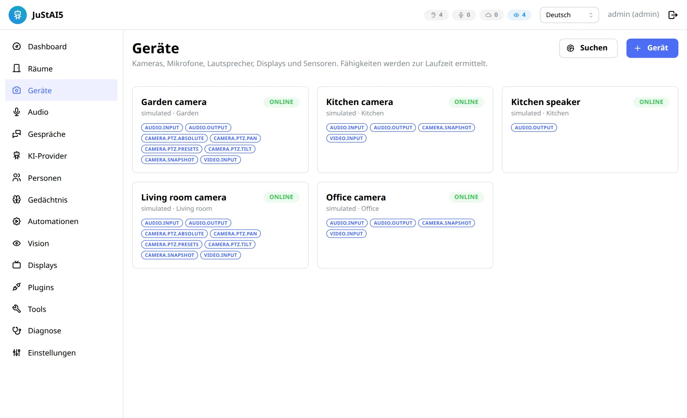

# Geräte

*Deutsch · [English](../DEVICES.md)*

Ein **Gerät** ist ein physisches oder virtuelles Gerät mit Fähigkeiten
(Capabilities). Geräte sind unabhängig von Endpoints: Eine Kamera kann Bild und
Mikrofon liefern, der Lautsprecher kann ein anderes Gerät sein
([ROOMS.md](ROOMS.md)).

## Fähigkeiten

Definiert in `justai_sdk/ports/devices.py` (`Capability`). Sie werden **zur
Laufzeit ermittelt** (Probe beim Hinzufügen und bei jeder Verbindung), nicht aus
dem Modellnamen geraten:

`video.input`, `audio.input`, `audio.output`, `audio.full_duplex`,
`camera.snapshot`, `camera.ptz.pan|tilt|zoom|presets|absolute`,
`camera.motion_events`, `camera.privacy_mode`, `display.text|image|dashboard|video|interactive|notifications|fullscreen`,
`sensor.motion`, `sensor.contact`.

Ob ein Stream tatsächlich Audio enthält, misst der Core über go2rtc
(`probe_medias`), nicht über Herstellerangaben.

## Hinzufügen

* **Netzwerksuche** (Admin-UI → Geräte → Suchen): Tapo (Port-Signatur),
  ONVIF WS-Discovery (Unicast an alle Hosts des Bereichs, weil Multicast aus
  Docker-Bridge-Netzen meist nicht durchkommt), mDNS. Gescannt werden nur
  Bereiche, die der Admin unter *Einstellungen → Netzwerksuche* freigegeben hat,
  und nur private Netze (`devices/discovery.py`).
* **Manuell**: Treiber wählen, Formular aus dem `config_schema` des Treibers
  ausfüllen, *Testen* (Probe ohne Speichern) und *Speichern*.

Zugangsdaten werden verschlüsselt gespeichert. go2rtc-Streams mit Zugangsdaten
legt der Core nur im Speicher an (`PATCH /api/streams`), sie landen nie in
`go2rtc.yaml` ([ADR 0004](adr/0004-go2rtc-media.md)).

## Getestete Kameras und Mithilfe

| Kamera | Stand | Was geprüft wurde |
| --- | --- | --- |
| **TP-Link Tapo C200** (Schwenk/Neigung, Netzbetrieb) | ✅ mit echter Hardware getestet | Video, Schnappschüsse, Mikrofon und Lautsprecher (Zwei-Wege-Audio), Wakeword → Antwort über den Kameralautsprecher, Echo-Kalibrierung, Schwenken/Neigen, Privatmodus |
| **TP-Link Tapo C410** (Akku, ohne Schwenk/Neigung) | ⚪ ungetestet | war beim Test meist im Schlaf und nicht erreichbar, daher ließ sich nichts prüfen. RTSP/ONVIF-Unterstützung und Lautsprecher sind ungeprüft; als Akkukamera schläft sie evtl. zwischen Ereignissen, was für den Einsatz als Mikrofon wichtig ist |
| **Andere Tapo-Modelle** | ⚪ ungetestet | der Treiber `tapo` sollte mit Modellen funktionieren, die den Tapo-Stream bieten, aber das hat noch niemand geprüft |
| **Andere ONVIF-/RTSP-Kameras** (Reolink, Hikvision, Dahua, Amcrest, …) | ⚪ ungetestet | der Treiber `onvif` ist implementiert und durch Unit-Tests abgedeckt, lief aber noch nicht an echten Kameras außer einer Tapo. Video und Schnappschüsse funktionieren sehr wahrscheinlich; **Lautsprecher (Backchannel) und PTZ hängen vom Modell ab** |

Auf echter Hardware wurde sonst nichts ausprobiert. Kauf bitte nicht allein wegen dieser
Tabelle eine Kamera für JuStAI: **Der Lautsprecher ist der kritische Teil.** Eine Kamera
ohne funktionierenden Audio-Backchannel lässt sich trotzdem als Mikrofon und Auge nutzen.
Die Antwort kommt dann von einem anderen Gerät (Tablet, Bildschirm, Smart Speaker).

### Probier gern deine eigene Kamera aus

Jede Kamera, die ONVIF oder RTSP spricht, ist einen Versuch wert (*Geräte* → **Suchen**
oder **+ Gerät**, Treiber `onvif`). Rückmeldungen sind sehr willkommen, auch negative:

* Eröffne ein Issue mit der Vorlage
  [Kamera-Bericht](https://github.com/naxeu/justai/issues/new?template=camera_report.yml):
  Modell, Firmware, Treiber und was funktioniert hat (Video, Mikrofon, Lautsprecher, PTZ).
* Nenne, welche Fähigkeiten der Gerätedialog nach dem Test anzeigt (Video, Mikrofon,
  Lautsprecher, PTZ), und hänge passende Logzeilen an. **Entferne vorher Passwörter und
  Adressen.**
* Ein kurzer Hinweis, was nicht ging, ist nützlicher als Schweigen. Viele Modelle
  unterscheiden sich nur in Kleinigkeiten (Stream-Pfad, Audio-Codec, ONVIF-Profil).

### Hilf mit, weitere Kameras zu unterstützen

Neue Kameras kommen über **Gerätetreiber-Plugins** dazu, kleine Python-Pakete, ohne dass
der Core geändert werden muss. Die beiden vorhandenen, `tapo` und `onvif` (Ordner
`plugins/`), dienen als Vorlage. Du musst nicht alles von Hand schreiben: Beschreibe die
Kamera einem KI-Coding-Assistenten und folge [Vibe Coding](VIBE_CODING.md).
Typische Beiträge:

* ein **Modellprofil** für den ONVIF-Treiber (Stream-Pfad, Audio-Codec, Eigenheiten des
  Backchannels),
* ein **neuer Treiber** für einen Hersteller mit eigenem Protokoll (Reolink, Eufy,
  Xiaomi, …),
* ein **Fix oder Test** für eine Kamera, die fast funktioniert.

Pull Requests und Plugins sind in [JuStAI](https://github.com/naxeu/justai)
willkommen. Die Schnittstellen stehen unter [Plugins](PLUGINS.md), die Testumgebung unter
[Entwicklung](DEVELOPMENT.md). Unsicher, wo du anfangen sollst? Eröffne eine
[Discussion](https://github.com/naxeu/justai/discussions) mit dem Kameramodell.

## Treiber

### TP-Link Tapo (`tapo`)

| Feld | Bedeutung |
| --- | --- |
| `host` | IP/Hostname |
| `cloud_password` | Tapo-Cloud-Passwort: Tapo-Stream mit Zwei-Wege-Audio und lokale Steuerung (PTZ, Presets, Privatsphäre-Modus) |
| `password_hash` | alternativ Hash des Cloud-Passworts – reicht für den Stream inkl. Talkback, **nicht** für die lokale Steuerung |
| `camera_username` / `camera_password` | Kamerakonto aus der Tapo-App: RTSP und ONVIF (PTZ über ONVIF Port 2020) |
| `stream` | `tapo` (Standard, mit Backchannel) oder `rtsp` (ohne Lautsprecher) |
| `horizontal_fov_deg` / `vertical_fov_deg` | Bildwinkel für PTZ-Tracking (Standard 95°/54°) |

Getestet mit echter Hardware:

* **C200**: Video, Snapshots, fMP4-Livestream, Mikrofon und Lautsprecher über
  go2rtc `tapo://`. Die Kamera **schaltet ihr Mikrofon stumm, solange ihr
  Lautsprecher spielt** (Hardware-Half-Duplex). Die Kalibrierung erkennt das:
  Es kommt kein Echo an, die konservative Latenz bleibt aktiv. Gemessene
  Ende-zu-Ende-Latenz Wiedergabe → Mikrofon: etwa 1,8 s. Barge-in während der
  Ausgabe ist mit diesem Gerät physikalisch nicht möglich.
* **PTZ der C200**: über die lokale Tapo-API (Cloud-Passwort) oder ONVIF
  (Kamerakonto). Die C200-Firmware kennt `getMotorCapability` nicht; die
  Schwenkfunktion wird deshalb über die Preset-API erkannt (die gibt es nur bei
  Schwenkmodellen), ersatzweise über ONVIF. Die lokale API scheitert gelegentlich
  beim Verbindungsaufbau (`pake_share failed`); dann übernimmt ONVIF. Getestet:
  Schwenken rechts und zurück aus der Admin-UI bzw. API.
* **C410** (Akku-Kamera): war beim Test meist nicht erreichbar (schläft), daher nicht
  geprüft. Ob sie RTSP/ONVIF und einen nutzbaren Lautsprecher bietet, ist offen; als
  Akkukamera schläft sie evtl. zwischen Ereignissen, was den Dauerbetrieb als Mikrofon
  einschränkt.

### ONVIF / RTSP (`onvif`)

Zwei Gerätetypen:

* **ONVIF**: `host`, `port` (Tapo: 2020), `username`, `password`, `backchannel`,
  Bildwinkel. Stream-URLs, PTZ-Fähigkeiten und Presets werden über ONVIF ermittelt.
* **RTSP**: `url` (ohne Zugangsdaten), optional `sub_url`, `username`, `password`,
  `backchannel` (ONVIF-Profile-T-Backchannel über go2rtc, falls die Kamera es kann).

### Simuliert (`simulated`)

Für Entwicklung, Tests und Vorführung ohne Hardware: Kamera (Bild aus Datei),
Mikrofon und Lautsprecher, optional PTZ. Der Lautsprecher speist das Ausgegebene
mit `echo_delay_s`/`echo_gain` wieder ins Mikrofon (Raumakustik, Rauschen,
optional `hardware_ducking` wie bei der C200). Mit dem Tool `simulator.say`
„spricht“ ein simulierter Benutzer (Piper-Stimme) in einen oder mehrere Räume
gleichzeitig (`also_devices`, `also_gain`), damit lassen sich z. B. Wakewords
hören, die zwei Räume gleichzeitig erreichen.

Abschaltbar mit `JUSTAI_ENABLE_SIMULATED_DEVICES=false`.

### Browser-Display (`browser-display`)

Wird beim Koppeln eines Display-Clients oder der Geräte-App angelegt
([DISPLAYS.md](DISPLAYS.md#geräte-app-handy-tablet-pc-als-mikrofon-lautsprecher-kamera)).
Mit der Geräte-App liefert es je nach Auswahl Mikrofon, Lautsprecher und Kamera
und ist damit wie eine Kamera mit Mikrofon in einem Endpoint verwendbar.

## Geräte per Sprache bedienen

Alltägliche Bedienung sind Tools des Assistenten (`tools/builtin/control.py`). Sie
brauchen das Recht `devices.control` (Rollen Bewohner und Admin; nie Sandbox-Plugins).
Geräte hinzufügen und Zugangsdaten ändern bleibt in der Oberfläche.

| Tool | Beispiel | Wirkung |
| --- | --- | --- |
| `devices.privacy_mode` | „Schalte die Kamera im Schlafzimmer aus“, „alle Kameras aus“, „Kamera wieder an“ | Privatsphäre-Modus von Kameras mit `camera.privacy_mode` (kein Bild, kein Ton) |
| `audio.listening` | „Hör im Schlafzimmer eine Stunde nicht zu“ | schaltet das Wakeword der Endpoints im Raum ab; eine einmalige Automation schaltet es nach der Pause wieder ein (1 Minute bis 24 Stunden, übersteht Neustarts) |
| `devices.reconnect` | „Die Kamera im Büro hat keinen Ton, verbinde sie neu“ | verbindet ein Gerät (oder alle Geräte eines Raums) neu |
| `devices.test_speaker` | „Teste den Lautsprecher in der Küche“ | kurzer Testton |
| `vision.analysis` | „Hör auf, die Wohnzimmerkamera auszuwerten“ | lokale Bildanalyse einer Kamera aus/an (Recht `vision.manage`); die Kamera läuft weiter |

Ohne Gerätenamen ist der Raum des Gesprächs gemeint. Jede Aktion steht im Audit-Log.
Treiber bieten den Privatsphäre-Modus über `handle.privacy()` an (Protokoll
`PrivacyControl` mit `get()` und `set(enabled)`); der Tapo-Treiber nutzt dafür pytapo
mit derselben Sperre wie PTZ. Live geprüft an der C200: an und aus per Textchat, Zustand
direkt an der Kamera kontrolliert.

## Deaktivieren statt Löschen

Im Geräte-Dialog oben rechts: Schalter **Aktiviert**. Ein deaktiviertes Gerät
behält Konfiguration, Zugangsdaten, Raum- und Endpoint-Zuordnung, aber JuStAI
baut keine Verbindung auf: kein Stream in go2rtc, kein Mikrofon, keine Bildanalyse,
keine Ausgabe dorthin. Endpoints zeigen das Gerät als „(deaktiviert)“, die
Audio-Diagnose meldet, dass der Endpoint nicht zuhört. Nach dem Aktivieren ist das
Gerät nach wenigen Sekunden wieder online (C200 getestet: ~6 s).

Löschen entfernt dagegen auch Zugangsdaten und Zuordnungen. Endpoints, deren Geräte
gelöscht wurden, bleiben bestehen und sind unter *Räume* mit „keine Geräte“
markiert.

## Status und Wiederverbindung

Der `DeviceManager` hält pro Gerät eine Laufzeit (Handle, Fähigkeiten, Status
`online`/`connecting`/`offline`/`disabled`/`no_driver`). Fällt ein Gerät aus, wird mit Backoff neu
verbunden; Statuswechsel erzeugen `device.status.changed`. Der Talkback-Pfad
verbindet sich automatisch neu. Beim Stoppen (Deaktivieren, Löschen, Neu verbinden)
hat jeder Schritt (Audio, Vision, Treiber, go2rtc-Streams) höchstens 10 s; ein
hängender Teil blockiert die anderen nicht und steht als `device step timed out`
bzw. `supervised task did not stop` (mit der Stelle, an der er wartet) im Log. Endpoints mit fehlenden Geräten melden ihren
Zustand in der UI, statt auf andere Räume auszuweichen.

## Diagnose

* `POST /api/devices/{id}/test-tone`: Testton über den Lautsprecher (über den Output Router)
* `GET /api/devices/{id}/snapshot.jpg`, `GET /api/devices/{id}/live.mp4`
  (Live-Video im Geräte-Dialog: startet automatisch, bleibt an der Live-Kante,
  beendet die Kameraverbindung beim Schließen)
* Admin-UI → *Audio*: Pegel, VAD, Wakeword-Score, Echo-Fenster, Duplex-Modus pro Endpoint
* Admin-UI → *Diagnose*: Event-Strom, Telemetrie, Audit-Log
