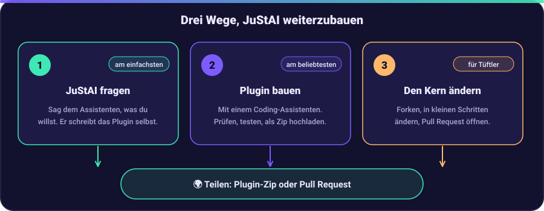

# Vibe Coding: JuStAI selbst weiterentwickeln

*Deutsch · [English](../VIBE_CODING.md)*

JuStAI wurde per Vibe Coding gebaut: Man beschreibt einem KI-Coding-Assistenten, was man
haben möchte, probiert das Ergebnis aus und steuert mit dem nächsten Satz nach, statt jede
Zeile selbst zu tippen. Das Projekt ist Open Source ([AGPL-3.0](../../LICENSE)), also kann
das jeder genauso machen. Du musst kein Profi-Programmierer sein. Du brauchst Geduld,
Neugier und die Gewohnheit, das Ergebnis des Assistenten zu prüfen.



Es gibt drei Wege mitzumachen, von „gar kein Code" bis „den Kern ändern". Fang beim ersten
an und geh nur weiter, wenn du es brauchst.

| Weg | Du brauchst | Ergebnis |
| --- | --- | --- |
| [1. JuStAI selbst fragen](#1-justai-selbst-fragen) | eine laufende Installation | ein neues Tool oder Plugin, vom Assistenten geschrieben |
| [2. Plugin mit einem Coding-Assistenten bauen](#2-plugin-mit-einem-coding-assistenten-bauen) | einen Rechner mit Python-Werkzeugen und einen KI-Coding-Assistenten | ein Plugin, das du zippen und installieren kannst |
| [3. Den Kern ändern](#3-den-kern-ändern) | die vollständige Entwicklungsumgebung | ein neues Feature oder ein Fix, auf Wunsch als Pull Request |

## 1. JuStAI selbst fragen

Der einfachste Weg: Sag oder schreib, was dir fehlt. Wenn kein vorhandenes Tool es
abdeckt, schreibt der Assistent selbst ein Plugin („Bau ein Plugin, das mir sagt, wenn
Strom billiger als 20 Cent ist."). Er erzeugt Code und Tests, prüft sie statisch, führt
die Tests in der Sandbox aus und lässt den Code begutachten. Danach gibst du es in der
Admin-Oberfläche unter *Tools* frei. Details, Grenzen und Rollback: [Selbst entwickelte
Plugins](PLUGINS.md#selbst-entwickelte-plugins).

Gute Wünsche sind konkret: Was soll es auslösen (Uhrzeit, Ereignis, Frage), was soll
herauskommen (gesprochene Antwort, Display, Ereignis) und welche Datenquelle darf es
nutzen.

## 2. Plugin mit einem Coding-Assistenten bauen

Plugins sind klein: ein Ordner mit `plugin.yaml` (Manifest), `plugin.py` und Tests. Damit
eignen sie sich ideal für Vibe Coding. Alles, was Hardware, KI-Anbieter oder externe Dienste
anbindet, ist ein Plugin ([PLUGINS.md](PLUGINS.md)).

### Einrichten

Du brauchst Linux, [uv](https://docs.astral.sh/uv/) und einen KI-Coding-Assistenten, der
Dateien in einem Ordner lesen und ändern kann (zum Beispiel Claude Code, Cursor, GitHub
Copilot oder ein ähnliches Werkzeug).

```bash
git clone https://github.com/naxeu/justai.git
cd justai
uv sync --all-packages
```

### Den Assistenten das Projekt zuerst kennenlernen lassen

Sag dem Assistenten vor der ersten Anfrage, dass er die passenden Dokumente lesen soll.
Eine kurze Kontextdatei im Projektordner (viele Assistenten lesen `CLAUDE.md` oder
`AGENTS.md` automatisch) erspart dir Wiederholungen. Ein Startpunkt:

```markdown
# JuStAI – Kontext für den Coding-Assistenten

- Lies docs/PLUGINS.md und docs/DEVELOPMENT.md, bevor du etwas änderst.
- Neue Funktionen sind ein Plugin unter plugins/<id>/ mit plugin.yaml, plugin.py, tests/.
  Referenz ist plugins/example-weather.
- Code, Kommentare, Logs und Tool-Beschreibungen sind Englisch. Texte, die ohne das
  KI-Modell gesprochen werden, gehören in backend/src/justai/i18n.py (en, de, it).
- Fordere nur die Berechtigungen an, die das Plugin wirklich braucht. Logge nie Geheimnisse,
  deklariere sie in secret_fields.
- Jedes Plugin braucht Tests mit justai_sdk.testing.FakePluginContext.
- Vor dem Abschluss ausführen: uv run ruff check . && uv run ruff format --check . und die
  Tests des Plugins.
```

### Eine erste Anfrage

Kopiere das Beispiel-Plugin und bitte um deine Änderung. Zum Beispiel:

> Lege ein neues Plugin `plugins/muell-erinnerung` auf Basis von `plugins/example-weather`
> an. Es soll ein Tool `muell.naechste` anbieten, das sagt, welche Tonne als Nächstes
> geleert wird, anhand der Abholtermine aus den Plugin-Einstellungen (`config_schema`).
> Ergänze einen Job, der es abends vor der Abholung über `services.say` ansagt. Schreibe
> Tests mit `FakePluginContext` und fordere nur die nötigen Berechtigungen an.

Dann in dieser Reihenfolge:

1. **Zuerst das Manifest lesen.** Die Liste `permissions` ist der wichtigste Teil. Fragt
   das Plugin mehr an, als es braucht? Lass den Rest entfernen.
2. **Tests ausführen** und Fehler vom Assistenten beheben lassen:

   ```bash
   uv run pytest plugins/muell-erinnerung/tests
   ```

3. **Qualitätsprüfungen ausführen:**

   ```bash
   uv run ruff check plugins/muell-erinnerung
   uv run ruff format --check plugins/muell-erinnerung
   ```

4. **Installieren:** Plugin-Ordner zippen und in der Admin-Oberfläche unter *Plugins →
   Installieren* hochladen. Hochgeladene Plugins starten immer als `untrusted` (in der
   Sandbox) und ohne Berechtigungen. Du prüfst und erteilst die Berechtigungen, trägst die
   Einstellungen ein und aktivierst es ([Ein Plugin verteilen](PLUGINS.md#plugin-verteilen)).
5. **Ausprobieren** per Sprache oder in der Admin-Oberfläche und dem Assistenten sagen, was
   passiert ist. Fehlermeldungen und Logs kopierst du zurück ins Gespräch.

Plugins, die Zugriff auf Geräte, das lokale Netz oder KI-Anbieter brauchen (zum Beispiel ein
neuer Kameratreiber), laufen nicht in der Sandbox. Das sind `trusted` Plugins im Core-Prozess;
lies zuerst [Berechtigungen](PLUGINS.md#berechtigungen) und prüfe solchen Code besonders
sorgfältig.

## 3. Den Kern ändern

Für neue Module, API-Routen, Änderungen an der Oberfläche oder Fixes im Kern.

### Entwicklungsumgebung einrichten

Folge [DEVELOPMENT.md](DEVELOPMENT.md): Docker, uv und Node 22. Der empfohlene
Entwicklungsmodus lädt Backend und Oberfläche bei jeder Änderung neu:

```bash
docker compose -f docker-compose.yml -f docker-compose.dev.yml up --build
```

Die Oberfläche läuft dann auf <http://localhost:5173>.

### In kleinen Schritten arbeiten

1. **Forke** das Repository auf GitHub, klone deinen Fork und lege einen Branch für deine
   Idee an.
2. **Beschreibe Ziel und Grenzen** gegenüber dem Assistenten: welches Modul, was sich nicht
   ändern darf, welche Tests es beweisen sollen. Verweise auf
   [ARCHITECTURE.md](ARCHITECTURE.md) und das Dokument des Bereichs, den du anfasst (zum
   Beispiel [AUDIO.md](AUDIO.md) oder [ROOMS.md](ROOMS.md)).
3. **Bitte zuerst oder gleichzeitig um Tests.** Fachlogik ohne I/O (zum Beispiel
   `output/router.py`) lässt sich leicht testen; siehe [TESTING.md](TESTING.md).
4. **Committe nach jedem funktionierenden Schritt**, damit du immer zurück kannst.
5. **Führe die Prüfungen aus, bevor du fertig bist:**

   ```bash
   uv run ruff check .
   uv run ruff format --check .
   (cd backend && uv run mypy src)
   uv run pytest backend/tests/unit
   (cd frontend && npm run lint && npm run typecheck)
   ```

6. **Aktualisiere die Dokumentation**, wenn sich Verhalten ändert, auf Englisch und
   Deutsch. Neue Oberflächentexte gehören in `en.ts`, `de.ts` und `it.ts`; der Build
   schlägt fehl, wenn ein Schlüssel fehlt.
7. **Öffne einen Pull Request** mit einer kurzen Beschreibung: was sich geändert hat,
   warum und wie du es getestet hast (auch, was du *nicht* testen konntest, zum Beispiel
   weil du keine Kamera hattest).

Die Konventionen, an die sich der Assistent halten muss, stehen in
[DEVELOPMENT.md](DEVELOPMENT.md#codequalität). Wenn du sie in die Kontextdatei von oben
übernimmst, werden die Ergebnisse deutlich besser.

## Tipps für gutes Vibe Coding

* **Kleine Schritte schlagen große Prompts.** Ein Feature, ein Commit.
* **Lass den Assistenten lesen, bevor er schreibt.** Nenne die Dateien und Dokumente, die er
  ansehen soll.
* **Lass dir erklären**, was du nicht verstehst, und bitte um ein Review seiner eigenen
  Änderung („Was kann schiefgehen, was hast du nicht getestet?").
* **Teste mit dem Simulator.** Der Treiber `simulated` liefert eine simulierte Kamera,
  Mikrofon und Lautsprecher, damit du Sprachfunktionen ohne Hardware ausprobieren kannst
  ([DEVICES.md](DEVICES.md)).
* **Sei ehrlich, was getestet ist.** Das Projekt sagt offen, welche Teile mit echter
  Hardware geprüft wurden ([TESTING.md](TESTING.md)). Mach das in deinem Pull Request auch.
* **Halte Geheimnisse aus Chat und Commits heraus.** API-Keys gehören in `.env` oder die
  Plugin-Einstellungen, nie in Prompts, Code oder das Repository.
* **Du bleibst verantwortlich.** Der Assistent kann sich irren und dabei überzeugt klingen.
  Lies, was in deinem Zuhause läuft, besonders Code mit Zugriff auf Kameras, Mikrofone oder
  das Netzwerk.

## Fragen, Fehler und Ideen

Alles läuft auf GitHub im [JuStAI-Repository](https://github.com/naxeu/justai):

| Ich möchte… | Wo |
| --- | --- |
| eine Frage stellen, zeigen was ich gebaut habe, über Ideen reden | [Discussions](https://github.com/naxeu/justai/discussions) |
| einen Fehler melden | [Issues → Bug report](https://github.com/naxeu/justai/issues/new?template=bug_report.yml) |
| ein Feature vorschlagen | [Issues → Feature request](https://github.com/naxeu/justai/issues/new?template=feature_request.yml) |
| selbst etwas beheben oder bauen | ein [Pull Request](https://github.com/naxeu/justai/pulls) (siehe die drei Wege oben) |

Fehler und Feature-Wünsche werden als [Issues](https://github.com/naxeu/justai/issues)
gesammelt. Bei einem Fehler bitte angeben, was du gemacht hast, was du erwartet hast, was
passiert ist, deine Hardware (zum Beispiel das Kameramodell) und, wenn möglich, die
Logzeilen. Poste nie Passwörter, API-Keys oder Kamera-Adressen mit Zugangsdaten. Englisch
und Deutsch sind beide willkommen.

## Lizenz

JuStAI steht unter der [AGPL-3.0](../../LICENSE): Du darfst es nutzen, ändern und
weitergeben, und wer eine geänderte Version als Netzwerkdienst anbietet, muss den Quellcode
der Änderungen unter derselben Lizenz veröffentlichen. Das Plugin-SDK (`sdk/python`) steht
unter MIT, damit deine Plugins jede Lizenz haben können. Siehe den Lizenzabschnitt im
[README](README.md#lizenz).
